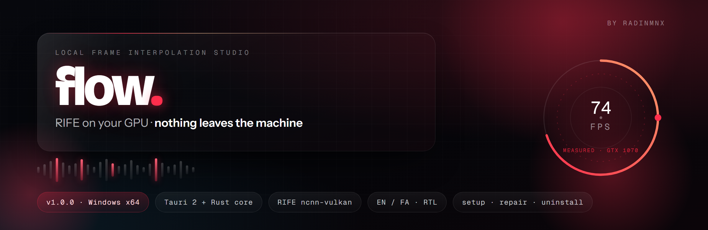
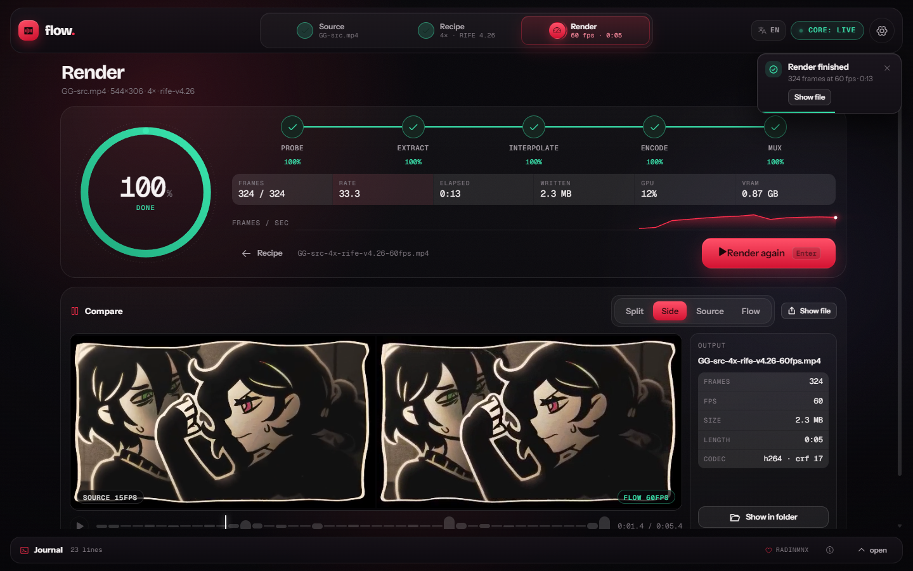
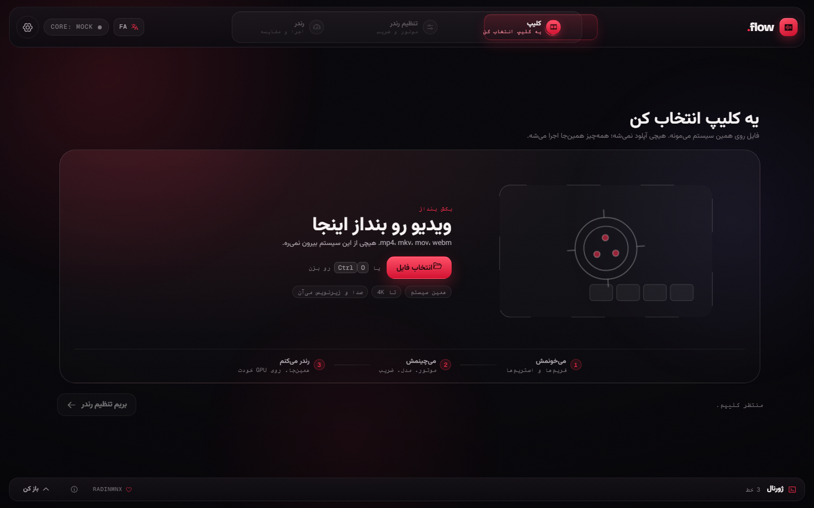
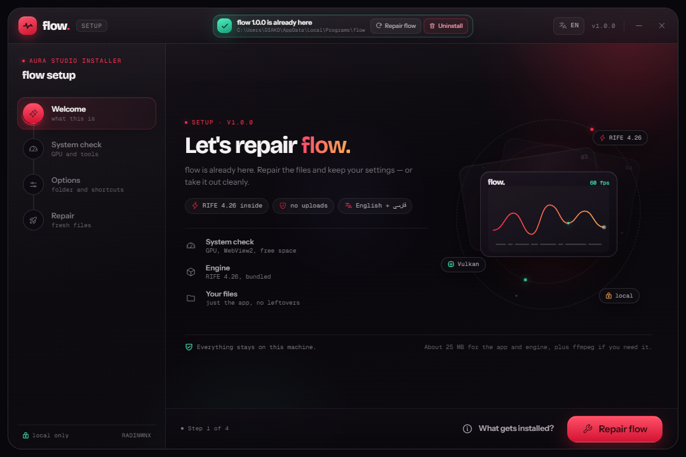
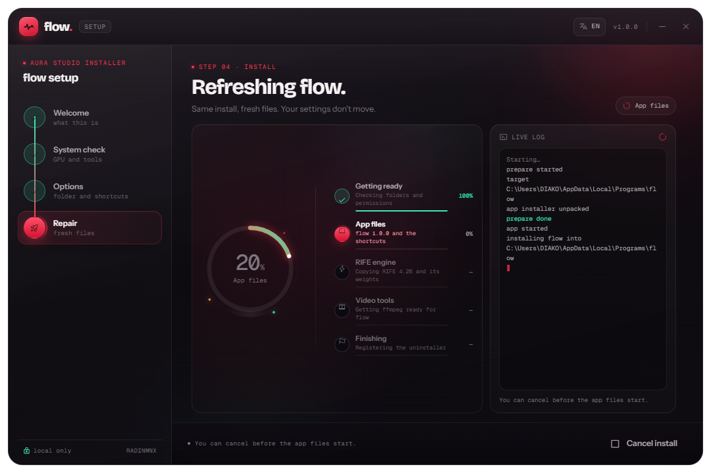
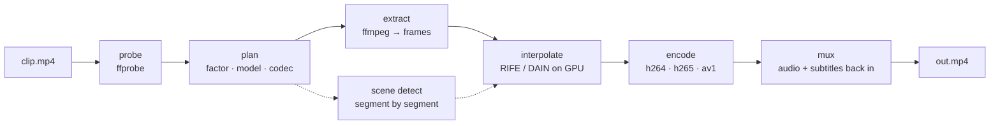

<div align="center">



# flow.

**A local frame-interpolation studio.** Drop a clip, pick a recipe, render it on your own GPU, compare the result frame by frame. Nothing is uploaded, nothing is metered, no account.

یه استودیوی محلی برای میون‌یابی فریم؛ کلیپ رو بنداز، دستور کار رو بچین، روی GPU خودت رندر بگیر. هیچی از این ماشین بیرون نمی‌ره.

[![release][badge-version]][releases] [![downloads][badge-downloads]][releases] [![build][badge-ci]][actions] [![license][badge-license]][license-file] [![platform][badge-platform]][releases]

[Install](#install) · [What it does](#what-it-does) · [Pipeline](#pipeline) · [From source](#run-it-from-source) · [Releases](#releases--ci) · [FAQ](#faq)

</div>

---

## At a glance

| | |
| --- | --- |
| **What** | Optical-flow frame interpolation (2×–8×) + re-encode, on your machine |
| **Engine** | RIFE ncnn-vulkan (bundled by the setup), DAIN ncnn-vulkan (auto-detected) |
| **Stack** | Tauri 2 · Rust (`flow-core`) · vanilla ES modules · hand-built aura design system |
| **Platform** | Windows 10/11 x64, Vulkan GPU |
| **Languages** | English · فارسی, with a real RTL layout (one switch, whole app) |
| **Install** | one `.exe` wizard · repair · uninstall, all in the same file |
| **License** | MIT, third-party notices in [NOTICE.md](NOTICE.md) |

## Gallery

| Render + compare, live core | فارسی, right-to-left |
| --- | --- |
|  |  |

| Setup wizard | Repair in place |
| --- | --- |
|  |  |

## What it does

- **Three-step wizard** — Source → Recipe → Render, with a sliding step capsule, View Transitions and a smooth-scroll surface. The clip strip samples seven real frames out of your file, not a placeholder.
- **Real interpolation** — `flow-core` probes with ffprobe, extracts frames with ffmpeg, interpolates with RIFE or DAIN on the GPU, encodes with x264 / x265 / AV1, then muxes the original audio and subtitles back in.
- **Scene-cut guard** — hard cuts are detected with ffmpeg and interpolated segment by segment, so motion never bleeds across a cut. Off by default for long takes, on when the clip has edits.
- **Honest numbers** — the plan shows an estimate and labels it as one; the run panel shows the measured rate, per-stage progress, ETA, GPU load, VRAM, output frames and bytes written.
- **Frame-locked compare** — split, side-by-side, source-only or flow-only, with a measured motion waveform and scrubbing that never lets the two halves drift.
- **One installer, three jobs** — the same aura window installs, repairs and uninstalls. It carries RIFE 4.26 with it, finds or downloads ffmpeg, and leaves a real Windows uninstall entry behind.
- **aura UI** — black/red neon, liquid-glass chrome, border beams, conic instrument rings, command palette (`Ctrl+K`), a real right-click menu, per-control tooltips, and a measured `74 fps` on a 74 Hz panel.

## Pipeline



Every stage reports progress, logs and byte counts over one IPC contract, and the same contract is answered by a mock core in the browser — so the UI can be developed and demoed without a GPU.

## Install

Grab the newest release and run one file:

| File | What it is |
| --- | --- |
| **`flow-setup-1.0.0-windows-x64.exe`** | the aura wizard — recommended. Carries the app **and** RIFE 4.26, finds or downloads ffmpeg, then installs, repairs or uninstalls |
| `flow_1.0.0_x64-setup.exe` | the plain Tauri NSIS installer. App only; you bring your own engine |

Both are in [Releases][releases]. They are **unsigned**, so SmartScreen will ask once — *More options → Run anyway*. The wizard checks WebView2, the GPU and free disk before it touches anything, and every stage shows real progress.

App data lives in `%LOCALAPPDATA%\studio.aura.flow` (engine, toolchain config, WebView profile); the app itself goes wherever you point it.

### Requirements

- Windows 10 or 11, x64, with **WebView2** (present on current Windows; the setup tells you if it is missing).
- A **Vulkan-capable GPU**. Developed and measured on a GTX 1070, so Pascal-class cards are the floor, not the ceiling.
- **ffmpeg + ffprobe** on `PATH`, or set `FLOW_FFMPEG` / `FLOW_FFPROBE`. The setup finds a matching pair, lets you browse for one, or downloads an official gyan.dev build when you ask it to.
- An interpolation engine. The setup bundles **RIFE 4.26 ncnn-vulkan** (MIT). The app also scans `$FLOW_ENGINE_ROOT`, `./engines` next to the executable, `%LOCALAPPDATA%\studio.aura.flow\engines`, and an existing **Flowframes** install — and only advertises an engine when both its binary and its weights are on disk.

### Use it in three steps

1. **Source** — drop the file in (or `Ctrl+O`). You get codec, resolution, fps, length, audio and subtitle tracks, plus seven real thumbnails.
2. **Recipe** — pick the engine and model, the factor (2×–8×), the codec and quality, the speed preset. The plan panel shows the expected output fps, frame count, size and time before you commit.
3. **Render** — watch the five stages, the measured rate and the frames/sec trace. Then compare: split, side-by-side or single, scrubbed and frame-locked.

## Performance

Measured on the development machine (GTX 1070, 16 GB, 74 Hz panel) — your numbers will move with your GPU and clip:

| What | Number |
| --- | --- |
| 4× of a 544×306 · 15 fps · 81-frame clip → 324 frames at 60 fps, `ultrafast` | **≈6 s** |
| Sustained interpolated rate in that run | **≈33 frames/s** |
| UI frame rate during install, render and compare | **74 fps** (the panel rate; p95 frame time 13.8 ms) |
| Wizard download | **25 MB** — it carries the 2.2 MB app installer and the 18 MB RIFE pack, compressed |

The UI is held to a no-dropped-frame budget: progress events are coalesced to one animation frame, ring geometry is cached, and nothing animates `blur`, `backdrop-filter` or layout properties.

## Run it from source

```bash
npm install
npm run app            # Tauri dev shell (starts its own local server)
npm run build          # app + NSIS installer -> target/release/bundle/nsis
npm run setup:package  # single-file aura wizard -> release/flow-setup-1.0.0-windows-x64.exe
```

UI-only work, against the labelled mock core:

```bash
npm run dev            # http://127.0.0.1:4211  (mock core, no GPU needed)
npm run setup:dev      # installer UI on http://127.0.0.1:4212/setup/  (?mock ?repair ?update ?uninstall)
npm run dist           # static bundle in dist/
```

`setup:package` needs the RIFE pack. Point `FLOW_RIFE_DIR` at a folder with `rife-ncnn-vulkan.exe` + `rife-v4.26/`, or let it read an existing Flowframes install. CI reads the same pack from the [`engine-pack`](#releases--ci) branch and verifies it with `node tools/verify-payload.mjs`.

### Tests

```bash
npm run test:core    # unit tests + real ffprobe / engine discovery
npm run test:real    # opt-in: full RIFE render, then audio + subtitle mux
npm run check:i18n   # every EN/FA key resolves, in both directions
node tools/live-smoke.mjs   # drives the real Tauri webview over CDP
```

`test:real` is `#[ignore]`d because it needs a GPU and a clip: put any short video at `dev/GG-src.mp4` (or edit the path) and run it — it asserts the exact output frame count and re-probes the file it wrote. The live smoke test launches the app with `WEBVIEW2_ADDITIONAL_BROWSER_ARGUMENTS=--remote-debugging-port=9223`, runs a real 4× job, verifies the output folder, loads the result into the compare player and saves a screenshot.

## Architecture

```
index.html · css/*        aura shell, wizard, instruments, overlays, RTL layer
src/*                     ES modules: wizard, source, recipe, run, compare, i18n,
                          context menu, tooltips, palette, toasts, mock core, IPC
crates/flow-core/         probe · plan · engines · scene · process · pipeline · gpu
src-tauri/                Tauri 2 shell: commands, events, capabilities, icons
setup/                    the wizard: frontend + src-tauri (install · repair · uninstall)
tools/                    dist build, vendor, i18n check, CDP live probes
.github/workflows/        ci.yml · release.yml
```

The IPC surface is frozen in [`src/ipc.js`](src/ipc.js): `probe`, `plan`, `start_job`, `cancel_job`, `scan_engines`, `pick_video`, `pick_dir`, `reveal_path`, `gpu_sample`, plus the events `flow://stage | progress | log | done`. The mock answers the same contract, and the header pill always says which core is live — `CORE: LIVE` or `CORE: MOCK`. No lies in the UI, including the numbers.

## Releases & CI

Two GitHub Actions workers, both on `windows-latest`:

| Workflow | Trigger | What it does |
| --- | --- | --- |
| [`ci.yml`](.github/workflows/ci.yml) | push + PR | `cargo test` on `flow-core`, i18n key check, a full release build of the app (no bundle) so compile breakage is caught early |
| [`release.yml`](.github/workflows/release.yml) | `v*` tag, or manual | builds the app + NSIS installer, pulls and **sha256-verifies** the RIFE pack from the `engine-pack` branch, builds the wizard, publishes a GitHub Release with both `.exe` files and a `SHA256.txt` |

The engine binary and weights (~18 MB, MIT) are not in the source tree. They live on the orphan [`engine-pack`](https://github.com/RADINMNX2/aura-flow/tree/engine-pack) branch so `main` stays clean, and CI checks them out into `setup/src-tauri/payload/` before the build. `tools/verify-payload.mjs` pins each file's sha256 and refuses a mismatch, so a release can never ship a silently swapped engine.

Cut a release: bump `version` in `package.json`, `src-tauri/tauri.conf.json` and `setup/src-tauri/tauri.conf.json` together, commit, tag and push.

```bash
git tag v1.0.1 && git push origin main --follow-tags
```

The tag triggers `release.yml`; the artifacts land on the Release page a few minutes later.

## Privacy

Probing, interpolation, encoding and muxing all run locally. There is no telemetry, no update pinger, no account and no network call from the app itself. The one download in the product is ffmpeg, and it only happens inside the setup, on your click, from gyan.dev, with the URL in the log; the RIFE engine is carried in the wizard rather than fetched. The design goal is the same as the design system's: everything you can see is doing work.

## FAQ

**Why not Flowframes?** Flowframes is a great app and this project reads from its engine folder if you have it. `flow.` exists because I wanted a wizard that behaves like the rest of the software, a compare view that never drifts, and a core I could reason about end to end.

**Why Tauri and not Electron?** A 2.2 MB installer, a Rust core that owns the process pipeline, and no Node runtime pretending to be a backend.

**Is 8× sane?** Sometimes. The plan panel warns you when the frame count gets absurd; the encoder is usually the bottleneck, not RIFE.

**Why is my output missing audio?** It shouldn't be — audio and subtitles are muxed back from the source. If the source had an unusual container, check the run log: the mux stage names the streams it carried.

**Will there be a macOS/Linux build?** The core is portable Rust and the UI is a webview, so the pieces are there; nobody has tested them. Contributions welcome.

## Contributing

Fork it, keep the change small, and run `npm run test:core` + `npm run check:i18n` before opening a PR. UI changes need a screenshot in the PR — this project is judged by eye, so show the eye what you did. Persian copy stays colloquial, never bookish.

## License & credits

MIT — see [LICENSE](LICENSE) and the third-party table in [NOTICE.md](NOTICE.md).

- App, core, wizard, design system: **[RADINMNX](https://github.com/RADINMNX2)**
- [FFmpeg](https://ffmpeg.org/) · [rife-ncnn-vulkan](https://github.com/nihui/rife-ncnn-vulkan) · [dain-ncnn-vulkan](https://github.com/nihui/dain-ncnn-vulkan) · [Flowframes](https://github.com/Flowframes/Flowframes)
- [Phosphor Icons](https://phosphoricons.com/) · [Lenis](https://lenis.darkroom.engineering/)
- Type: Bricolage Grotesque, Instrument Sans, Geist Mono, Vazirmatn (SIL OFL 1.1)

<div align="center">

*Built on a GTX 1070 in Tehran.* · [Releases][releases] · [Issues](https://github.com/RADINMNX2/aura-flow/issues)

</div>

[badge-version]: https://img.shields.io/github/v/release/RADINMNX2/aura-flow?style=flat-square&label=release&color=FF2E4C&labelColor=0B0D12
[badge-downloads]: https://img.shields.io/github/downloads/RADINMNX2/aura-flow/total?style=flat-square&label=downloads&color=E8ECF3&labelColor=0B0D12
[badge-ci]: https://img.shields.io/github/actions/workflow/status/RADINMNX2/aura-flow/ci.yml?style=flat-square&label=build&color=E8ECF3&labelColor=0B0D12
[badge-license]: https://img.shields.io/badge/license-MIT-3DDC91?style=flat-square&labelColor=0B0D12
[badge-platform]: https://img.shields.io/badge/platform-Windows%20x64-4C9EE8?style=flat-square&labelColor=0B0D12
[releases]: https://github.com/RADINMNX2/aura-flow/releases/latest
[actions]: https://github.com/RADINMNX2/aura-flow/actions
[license-file]: LICENSE
